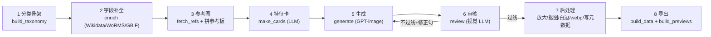

# 全球鱼类贴纸库 · 项目说明文档（v0.1 草案）

> [!WARNING]
> 本文是 v0.1 技术草案。遇到冲突时，以 [需求文档.md](需求文档.md) v0.2 和 [调研报告.md](调研报告.md) 为准。主要更正如下：
> - 物种数是 **38,184**（Catalogue of Life 实查）。分类骨架用 **Catalogue of Life**（CC BY 4.0），Catalog of Fishes 只用来核对。
> - 不要求“鳍条数可以数”，只检查鳍的个数、位置和形状。
> - `species.json` 必须按目拆分（单文件 < 20 MB）。
> - 新增参考图分级（A/B/C/D）和 `colorConfidence` 字段。
> - 英文名可以为空。

> 项目代号：`world-fish-sticker`（暂定，可改）
> 参照对象：[alchaincyf/huashu-bird-sticker](https://github.com/alchaincyf/huashu-bird-sticker)，仓库结构和发布方式与它保持一致，内容换成全世界的鱼。
> 本文档回答五件事：做什么、仓库长什么样、数据从哪来、图怎么生成和审核、按什么顺序做。

---

## 1. 目标与范围

| 项目 | 鸟类原版 | 鱼类版目标 |
|---|---|---|
| 分类依据 | AviList v2026 | **Eschmeyer's Catalog of Fishes**（以下简称 CoF）定有效种；字段从开放授权来源取（见第 4 节） |
| 物种数 | 11,011 种 / 45 目 / 249 科 | **约 3.6–3.7 万种**（以 CoF 当年版本为准），约 80+ 目、500+ 科 |
| 产物 | 每种一张透明底白边 webp 贴纸 + 结构化数据 | 相同 |
| 授权 | 贴纸 CC BY 4.0，数据 MIT | 相同（第三方字段沿用各自授权，见第 4 节） |
| 收录规则 | 不收灭绝种（另保留 43 种有贴纸的灭绝种） | 不收灭绝种，化石种不收；有贴纸的近期灭绝种保留并标注 `extinctionStatus` |

**不做的事**：不做鉴定工具，不承诺图鉴级准确度；贴纸是 AI 插画，元数据和 README 必须写明这一点。

> [!NOTE]
> 鱼的物种数约是鸟的 3.3 倍，成本、存储、审核量都按这个倍数放大。见第 8 节分期。

---

## 2. 仓库结构（与原版一一对应）

```
world-fish-sticker/
├── README.md                     # 英文主 README
├── README.zh-Hans.md             # 以及 zh-Hant/ja/ko/es/fr/de/pt/ru/ar，共 11 种语言
├── CHANGELOG.md                  # 中英双语更新记录
├── CONTRIBUTORS.md               # 纠错贡献者
├── LICENSE.md                    # 双授权说明
├── LICENSES/
│   ├── CC-BY-4.0.txt
│   └── MIT.txt
├── NOTICE.md                     # 第三方数据来源与授权（逐字段写清）
├── .zenodo.json                  # 申请 DOI 用
├── .github/ISSUE_TEMPLATE/
│   ├── config.yml
│   ├── sticker-error.yml         # 贴纸画错
│   ├── name-error.yml            # 鱼名错误
│   ├── family-review.yml         # 帮忙审一个科
│   └── takedown.yml              # 参考照片作者撤图申请
├── docs/
│   ├── how-the-stickers-are-made.md
│   └── how-the-stickers-are-made.zh-Hans.md
├── data/
│   ├── README.md                 # 字段说明、覆盖率、参考照片授权统计
│   ├── species.json              # 完整数据，一种一条
│   ├── species.csv               # 摊平版
│   ├── stickers.json             # 轻量索引（学名/英文名/中文名/路径/CDN 前缀）
│   ├── names.csv                 # 多语种鱼名
│   ├── languages.json            # 语言代码与来源列
│   ├── crosswalk-<旧版>-<新版>.csv # 分类版本升级时的对照表（首版可先不放）
│   └── field-guide.zh-Hans.json  # 中文图鉴文字（可选，CC BY-SA）
├── previews/
│   ├── header.webp  hero.webp  orders.webp
│   ├── families/<类群>.webp       # README 画廊用的拼图
│   └── hero.json  orders.json  families.json   # 拼图里用了哪些种
├── stickers/<目>/<科>/<属_种>.webp
└── pipeline/                     # ★ 原仓库没有公开这部分，我们必须自己写（见第 6 节）
```

> [!IMPORTANT]
> 原仓库**只公开了产物和方法说明，没有生成和审核的代码**。“全部文件一样”只能做到结构和格式一致，`pipeline/` 是这个项目真正的工作量。是否把 `pipeline/` 开源可以后定。
>
> 另外原仓库里没有视频文件，只有 webp 图片和 JSON/CSV 数据。如果你说的“视频”指别的东西（比如配套的科普短视频），要单独立项。

---

## 3. 数据结构：`species.json`

顶层：`{ "version", "taxonomy", "count", "species": [...] }`，按分类顺序排列。

每条记录示例（字段对照鸟类版改写）：

```json
{
  "id": "Amphiprion_ocellaris",
  "scientificName": "Amphiprion ocellaris",
  "authority": "Cuvier, 1830",
  "taxonomy": {
    "system": "Catalog of Fishes 2026-xx",
    "seq": 21534,
    "class": "Actinopterygii",
    "order": "Ovalentaria incertae sedis",
    "family": "Pomacentridae",
    "familyEnglish": "Damselfishes",
    "genus": "Amphiprion"
  },
  "zh": { "pinyin": "", "aliases": [], "order": "", "family": "雀鲷科", "wikipedia": "" },
  "names": { "en": "Clown anemonefish", "zh-Hans": "眼斑双锯鱼", "zh-Hant": "", "ja": "カクレクマノミ" },
  "ids": {
    "cof": "", "fishbase": 0, "worms": 0, "gbif": "", "wikidata": "",
    "inaturalist": 0, "ncbi": 0, "bold": ""
  },
  "habitat": {
    "environment": ["marine"],          // marine / brackish / freshwater，取自 WoRMS 标记
    "depthM": [1, 15],
    "zone": "reef-associated"
  },
  "range": { "text": "", "faoAreas": [57, 71], "zh-Hans": "" },
  "extinctionStatus": null,
  "traits": { "maxLengthCm": 11, "source": {} },
  "conservation": { "iucn": "LC", "cites": null, "chinaClass": null },
  "dimorphism": "none",                 // none / sexual / phase（如隆头鱼的初期相/终期相）
  "sticker": {
    "file": "stickers/<目>/Pomacentridae/Amphiprion_ocellaris.webp",
    "kind": "ai-illustration",
    "view": "lateral",                  // ★ 鱼类新增：lateral / dorsal / eyed-side / vertical
    "coloration": "live",               // ★ 鱼类新增：live / inferred-from-preserved
    "reviewScore": 90,
    "meetsQualityBar": true,
    "license": "CC-BY-4.0",
    "reference": { "type": "photo|reference-board|specimen", "page": "", "author": "", "license": "" }
  },
  "taxonConcept": "same",
  "previous": [],
  "dataNotes": []
}
```

和鸟类版相比的变化：
- `taxonomy` 增加 `class`：软骨鱼、辐鳍鱼、肉鳍鱼、盲鳗/七鳃鳗要分开。
- 新增 `habitat`：鱼的分布要看水域和深度，鸟没有这个维度。
- `sticker.view`：鱼的标准视角不止一种，见 5.2。
- `sticker.coloration`：大量深海种只有福尔马林标本照，活体颜色是推测的，必须单独标出来。
- `sticker.reference.type` 增加 `specimen`（标本照）。

`stickers.json`、`species.csv`、`names.csv` 的列结构照搬原版，把 eBird/Avibase 换成 CoF/FishBase/WoRMS 编号即可。

---

## 4. 数据来源与授权（最关键，先定下来）

原版能用 MIT/CC BY 发布，是因为主要来源（AviList、IOC、AVONET、Wikidata）都是 CC BY 或 CC0。**鱼类最常用的 FishBase 是 CC BY-NC（禁止商用），不能把它的内容直接搬进 MIT 数据。**

| 字段 | 建议来源 | 授权 | 说明 |
|---|---|---|---|
| 有效种名单、命名人 | Catalog of Fishes（加州科学院） | 版权归加州科学院，**不是开放授权** | 只用来核对有效种，不整体转载；要不要发邮件申请授权？⚠️需确认 |
| 分类骨架（目/科/属） | Catalogue of Life / Fish Tree of Life（Betancur-R 等） | CoL：CC BY 4.0 | 用开放来源输出 |
| 海水种、生境标记 | WoRMS | CC BY 4.0 | 有 AphiaID、海水/淡水/半咸水标记 |
| 多语种名 | Wikidata | CC0 | FishBase 俗名是 NC，不要用 |
| 中文名 | Wikidata、中文维基；大陆/台湾的权威名录 | ⚠️ 逐个确认 | 台湾鱼类资料库、《拉汉世界鱼类系统名典》等要先确认能不能引用 |
| 外部编号 | FishBase SpecCode、GBIF、Wikidata、iNat、NCBI、BOLD | 编号本身是事实，可以收录 | 只收编号，不收 FishBase 正文 |
| 保护等级 | Wikidata P141（IUCN）、CITES 附录、《国家重点保护野生动物名录》 | CC0 / 公开 | IUCN 官方数据不能直接转载 |
| 形态性状 | FISHMORPH（淡水）等开放数据集 | ⚠️ 逐个确认 | 相当于鸟类版的 AVONET；海水鱼缺少同等开放数据，可以先空着 |
| 参考照片 | Wikimedia Commons、iNaturalist（CC 授权）、学术论文图 | 各异 | 仓库里不放照片，只记出处、作者和授权 |

> [!WARNING]
> 授权没确认的字段宁可留空，也不要先收进来再说。原版的做法是：范围变了的种宁可空着也不硬套鸟名。这个原则要照搬。

---

## 5. 贴纸规范（鱼类版）

### 5.1 通用规范
- 画布 1536×1024 横版，只画一条鱼，完整居中，四周留空，吻端和尾鳍末端都不出画。
- 背景纯平涂浅灰 `#D9D9D9`，没有阴影，不画描边。白边在后处理时统一加。
- 写实图鉴风格，鳞片和鳍条清晰，不画成卡通。
- **头朝左**，正侧面，眼睛完整可见，嘴闭合（特殊口型除外）。
- **所有鳍都展开**：背鳍、臀鳍、尾鳍、胸鳍、腹鳍都要看得见，鳍的个数、位置和形状要对。不要求鳍条数和鳞片数准确，AI 做不到这个精度。
- 画成年个体活体的典型体色，不画标本褪色后的颜色，也不画幼鱼。有性二型或体色相变的种（雀鲷、隆头鱼、鹦嘴鱼、慈鲷等），默认画雄性或终期相，在 `dimorphism` 里注明。

### 5.2 特殊体形（相当于鸟类版的“游水、飞行等少数类群另定姿势”）

| 类群 | `view` | 规范 |
|---|---|---|
| 一般鱼类、鲨鱼 | `lateral` | 左侧面，鳍展开 |
| 比目鱼（鲽形目） | `eyed-side` | 画有眼的那一侧，并注明是左眼型还是右眼型 |
| 鳐、魟、电鳐 | `dorsal` | 背面俯视，吻端朝上或朝左统一定一种 |
| 海马、海龙 | `vertical` | 竖直，头朝左 |
| 鳗类、盲鳗、七鳃鳗 | `lateral` | 全长水平展开，允许轻微 S 形；画布不够长时缩小，不能截断 |
| 鮟鱇、深海鱼 | `lateral` | 拟饵、发光器必须画出 |
| 鲀、箱鲀 | `lateral` | 画正常不充气的状态 |

### 5.3 特征卡模板（每种一张，交给生图模型）
```
这条鱼：<英文名>，<学名>。<雌雄/相>。
视角：<lateral/dorsal/...>
体形：体长约为体高的 X 倍；头长占体长约 Y%；尾鳍 <叉形/圆形/截形/新月形/矛形>。
鳍式：背鳍 <几个、棘几条 + 软条几条>；臀鳍 <...>；脂鳍 <有/无>；腹鳍位置 <腹位/胸位/喉位/无>。
头部：口位 <上位/端位/下位>；须 <几对、在哪>；眼 <大小、位置>。
体色与斑纹：<逐项写，写具体位置和数量，如“体侧 3 条白色横带，中间那条在背鳍下方”>
侧线：<完整/中断/无>
和最易混的种的区别（一定要画出来）：<...>
这类鱼的经验：<同类贴纸以前常犯的错>
```

> [!TIP]
> 原版最重要的经验是“写具体，包括理所当然的部位”。对鱼来说，最容易被画成“一般的鱼”的地方是**鳍的数量和位置、脂鳍、须、尾鳍形状、鲨鱼的鳃裂数**，这些必须写进特征卡。

### 5.4 审核标准
另一个视觉模型按五项打 0–4 分：

1. **辨识**：一眼能认出是这个种，和近缘种区分得开
2. **体色与斑纹**
3. **鳍**：数量、位置、形状、鳍棘/软条
4. **头部**：口位、须、眼、鳃盖
5. **体形比例**：体高、头长、尾柄、尾鳍形状

**过线条件**：五项都 ≥3，辨识 = 4，而且能当图鉴图版用。
**强制检查（相当于原版的“数脚趾”）**：背鳍个数、脂鳍有无、腹鳍位置、须的对数、鲨鱼的鳃裂数（5–7）、比目鱼的眼侧。任何一项不对就直接判不过线。

不过线时，审核员要给出 1–3 条能直接放进提示词的修正句（例如“第二背鳍的起点在臀鳍起点正上方”，而不是“鳍不对”），作为下一轮生成的输入。

---

## 6. 生成流水线（`pipeline/`，需要自己开发）



| 步骤 | 要点 |
|---|---|
| 状态管理 | 用 SQLite 记录每个种走到哪一步、生成了几次、每次的分数和修正句，保证可以断点续跑 |
| 参考图 | 优先 CC0/CC BY 的照片；能找到多位拍摄者时拼成参考板；只有标本照时 `type=specimen`，`coloration=inferred-from-preserved` |
| 同科样板 | 每科先人工挑 1 张过线贴纸当“姿势样板”，提示词里写明只学姿势和画法，不学颜色 |
| 后处理 | 放大（Real-ESRGAN 等）→ 抠图（BiRefNet/rembg）→ 加白边 → 长边约 1000px 的 webp |
| 元数据 | 用 exiftool 写 XMP/IPTC：`DigitalSourceType = trainedAlgorithmicMedia`、AI 系统名、“未经专家核对”、授权、仓库链接 |
| 上限 | 每种最多重画 N 次（建议 6 次）；仍不过线的进人工队列，或只重画局部（原版对脚就是这么处理的） |

---

## 7. 成本与存储估算（按 3.6 万种粗算，开工前要实测）

- **生成次数**：原版在严标准下几乎所有贴纸都重画过。按平均每种 3–4 次算，约 **11–15 万次生图 + 同等次数的审核调用**。
- **费用**：总价 ≈ 生图次数 × 单价 + 审核次数 × 单价。单价随模型和画质差异很大，先用 200 种试点跑出真实的“平均几次过线”再算预算。
- **存储**：原版平均每张约 60 KB，3.6 万张约 **2.2 GB**。GitHub 建议单仓库不超过 1 GB（硬上限 5 GB）。可选方案：
  1. 按纲或按目拆成几个仓库；
  2. 把长边压到 800px 或提高 webp 压缩率；
  3. 图片放 Cloudflare R2 等对象存储加 CDN，仓库只放数据。
  jsDelivr 对大仓库的支持需要实测。

---

## 8. 分期计划

| 阶段 | 内容 | 验收 |
|---|---|---|
| P0 数据骨架 | 定授权方案；拉出全部有效种名单和编号；完成 `species.json` 雏形 | 授权表签字确认；覆盖率报告 |
| P1 试点 | 200 种，覆盖 5.2 节所有特殊体形；调提示词和审核标准 | 过线率、平均重画次数、单种成本 |
| P2 首发 | 先做中国有分布的鱼（约 3,000–5,000 种）或观赏鱼和经济鱼类，出 v1.0 | README、画廊、数据全部到位 |
| P3 全量 | 按科分批推进到全部物种 | 每种都有贴纸，全部过线 |
| 持续 | 处理纠错 issue、撤图申请（7 天内）、跟进分类年度更新 | CHANGELOG 每版都记 |

---

## 9. 合规与署名

- 原仓库的**名字、品牌（花叔、Bird Album、鸣迹）、文档原文**都不要照抄。结构和方法可以参考，文字要自己写；README 里可以注明“受 huashu-bird-sticker 启发”。
- 每张贴纸都写明是 AI 生成；README 写清局限，并开放纠错和“帮忙审一个科”的渠道。
- 参考照片不进仓库；`sticker.reference` 记录出处、作者和授权；提供撤图模板，承诺 7 天内替换。
- 用于商用的使用者可以按 `reference.license` 自行筛选，`data/README.md` 要给出各类授权的数量统计。

---

## 10. 待你决定的问题

1. 项目名和品牌（仓库名、配套网站有没有）
2. 分类依据：是否联系加州科学院申请 Catalog of Fishes 的使用授权，还是完全基于 Catalogue of Life 加 WoRMS
3. 首发范围：中国鱼类、观赏鱼，还是直接全量
4. 预算上限，以及生图和审核分别用哪个模型
5. `pipeline/` 代码是否开源
